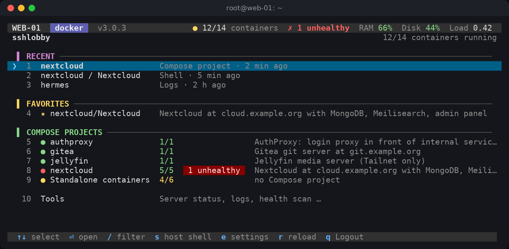
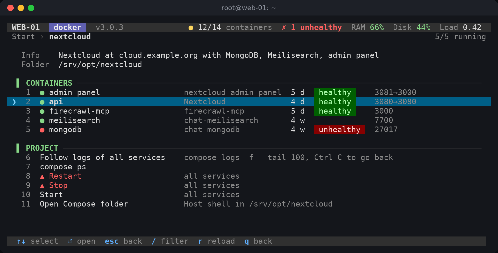
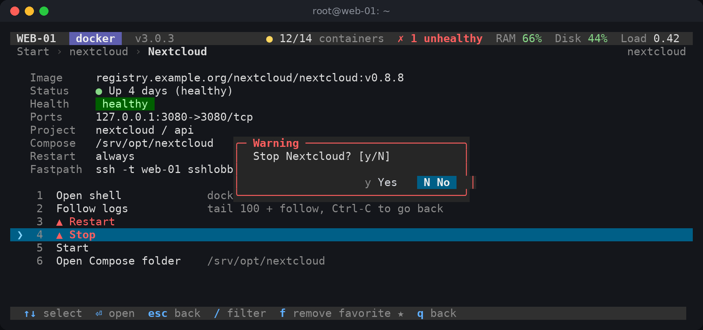
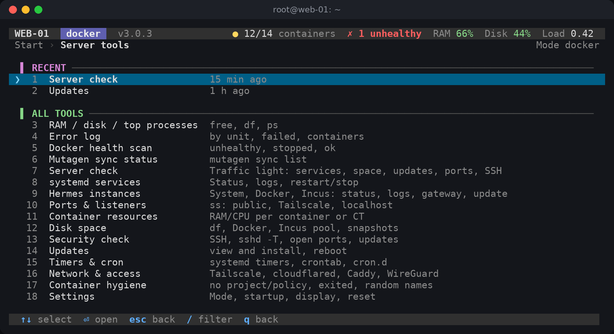
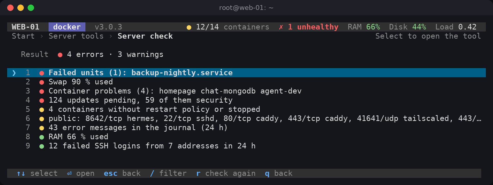
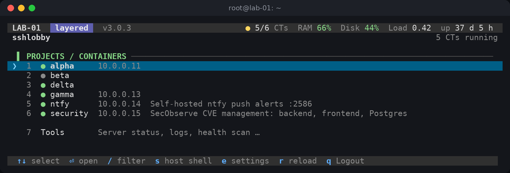
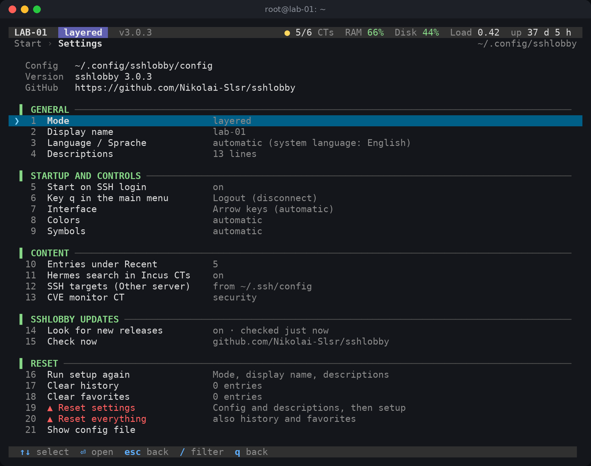
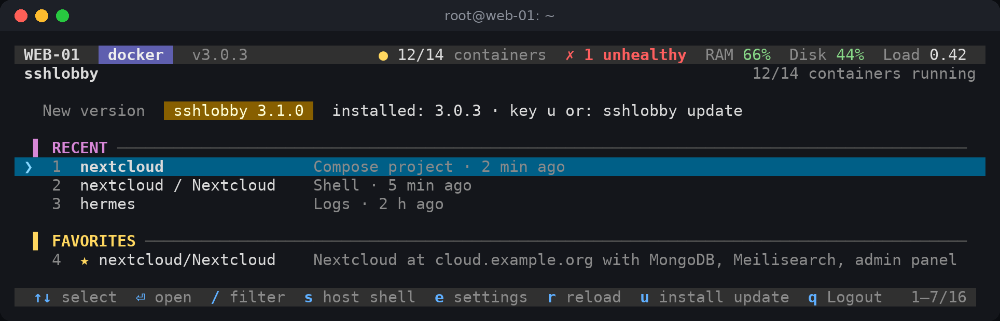

# sshlobby

A terminal dashboard that opens when you log in to a server over SSH. It lists your Docker Compose
projects or Incus containers and gets you into a shell, the logs or a restart in a few keystrokes. It
also bundles the checks you would otherwise run by hand: failed services, open ports, disk space,
pending updates.



- Pure Bash. Needs `jq` and `tput`; nothing to compile, no daemon.
- Arrow keys, filter with `/`, numbers to jump. Without a terminal the same menu works line by line.
- Three modes: Docker on the host, Incus containers, or Incus containers with Docker inside.
- Nothing happens on its own. Restart, stop, updates and reboot always ask first.
- English and German interface. A new language is one more line per text in a text file.

## Contents

- [Screenshots](#screenshots)
- [Install](#install)
- [Usage](#usage)
- [Modes](#modes)
- [Server tools](#server-tools)
- [Configuration](#configuration)
- [Updates](#updates)
- [Languages](#languages)
- [Uninstall](#uninstall)
- [Development](#development)

## Screenshots

| | |
|---|---|
|  |  |
| A Compose project: containers with health and ports, project actions | Every action that changes something asks first |
|  |  |
| Server tools that fit the current mode | The server check collects problems from all tools |
|  |  |
| Incus containers with Docker inside (mode `layered`) | Settings (key `e`), including reset with backup |

The screenshots are rendered from the test fixtures with `tools/dev/screenshots.sh`.

## Install

Requirements: Linux, Bash 4.3 or newer, `jq`, `tput` (package `ncurses-bin`), `awk`, root access,
and `docker` or `incus`. Optional: `tmux` (updates keep running if the connection drops),
`systemctl` and `journalctl` (services and logs), `ss` (ports), `curl` or `wget` (release check and
`sshlobby update`).

```sh
git clone https://github.com/Nikolai-Slsr/sshlobby.git
cd sshlobby
sudo ./install.sh
```

`install.sh` copies the program to `/usr/local/lib/sshlobby/`, links `/usr/local/bin/sshlobby` and
adds a marked block to `~/.bashrc` that starts the dashboard on SSH login. Running it again updates
the program and leaves an up-to-date block alone. Later versions install with `sudo sshlobby update`
(see [Updates](#updates)); in a git checkout, run `git pull` and `sudo ./install.sh` again.

The block only runs for interactive SSH logins with a terminal. `scp`, `sftp`, `ssh host command`
and scripts are not affected. To skip the dashboard, set `SSHLOBBY_SKIP=1`, or press `s` in the
menu for a normal shell.

You cannot lock yourself out: only `q` in the main menu logs out. `s`, Ctrl-C, Ctrl-D or a crash
all end in the normal shell.

On the first start sshlobby looks at the server, suggests a mode and asks for a display name.
Coding agents find step-by-step instructions in [CLAUDE.md](CLAUDE.md).

## Usage

| Key | Action |
|---|---|
| `↑` `↓`, `k` `j`, Page Up/Down, Home/End | move |
| `Enter`, `→`, `l` | open |
| `←`, `Esc`, `h`, `b`, Backspace | back |
| `/` | filter the list as you type |
| `1`…`9` | jump to an entry |
| `f` | add or remove a favorite (container, Incus container and service screens) |
| `s` | normal shell on the host |
| `e` | settings |
| `u` | install a new release (only shown when one is available) |
| `r` | reload |
| `q` | log out (main menu) or back |

The main menu shows recent targets (Compose projects, containers, Incus containers, each with the
action it repeats) and favorites at the top, then the projects or containers, then the server tools.
Recently used tools appear at the top of the tools menu. Before a shell opens, sshlobby checks that the container is running. Ctrl-C in
logs, shells and tools only stops that command and returns to the menu.

Without a terminal (pipes, scripts) the same menu prints numbered lines: type the number and Enter,
`b` or an empty line goes back.

### Command line

```sh
sshlobby --go nextcloud/app      # docker: shell in a container (<container> or <project>/<container>)
sshlobby --go web                # incus, layered: shell in an Incus container
sshlobby --go web/app-1          # layered: shell in a Docker container inside an Incus container
sshlobby --list                  # overview without the menu
sshlobby --setup                 # choose the mode again
sshlobby --settings              # open the settings
sshlobby --reset                 # reset everything (with backup), then setup
sshlobby --mode incus            # use a mode for this run only
sshlobby update                  # install a new release (asks first), see Updates
sshlobby --help
sshlobby --version
```

From another machine: `ssh -t <server> sshlobby --go <target>`. `--go` checks the target first and
exits with 1 if it does not exist or is not running.

Exit codes of the menu: 0 end, 10 host shell, 20 log out. The login hook logs out only on 20.

## Modes

| Mode | For | Levels |
|---|---|---|
| `docker` | Docker containers on the host | Compose project → container → action |
| `incus` | Incus containers | container → action |
| `layered` | Incus containers that run Docker inside | Incus container → Docker container → action |

Container actions: shell (`bash`, falls back to `sh`), follow logs, restart, stop, start, open the
Compose folder, details (image, status, health, ports, restart policy). Compose projects add logs of
all services, `compose ps` and restart, stop or start of the whole project. Incus containers add
start, stop, restart, `incus info`, the log and resources.

## Server tools

The tools menu shows only what fits the mode and is installed on the server.

| Tool | Shows |
|---|---|
| Server check | one list of problems from the tools below; each entry opens the matching tool |
| systemd services | services by group, logs, status, unit file; restart, stop, enable with confirmation (critical units like `ssh` need the unit name typed) |
| Ports and listeners | listening sockets by reach: public, Tailscale, private, localhost |
| Container resources | RAM and CPU per container or Incus container |
| Disk space | file systems, journal, Docker images and volumes, Incus pool and snapshots |
| Security check | `sshd -T` settings, failed logins, public ports, pending security updates |
| Updates | pending packages; refresh, install security updates or all updates, reboot after typing the hostname |
| Timers and cron | systemd timers, crontab, `cron.d` |
| Network and access | Tailscale, Cloudflare Tunnel, Caddy, WireGuard |
| Container hygiene | containers without project or restart policy, exited containers, random names |
| Hermes instances | [Hermes agent](https://hermes-agent.nousresearch.com) instances on the host, in Docker and in Incus containers |
| Error log, RAM and disk, Docker health scan, Mutagen | quick views |
| Other server (SSH) | jump to hosts from `SSH_HOSTS` or `~/.ssh/config` |
| Incus overview, new project, CVE alerts | Incus modes; CVE alerts need `CVE_CT` |

Only the services, updates and Hermes tools change anything, and only after a confirmation.
[docs/TOOLS.md](docs/TOOLS.md) lists what each tool reads and runs.

## Configuration

Everything in the settings menu (`e`) is stored in `~/.config/sshlobby/config` as `KEY=value`. The
file is parsed, never run as shell code. Unknown keys and invalid values are ignored.

| Key | Values (default first) | Effect |
|---|---|---|
| `MODE` | `docker`, `incus`, `layered` | mode |
| `HOST_LABEL` | text, up to 40 characters | name in the header (default: `hostname -s`) |
| `LANGUAGE` | empty, `en`, `de` | interface language (empty: system language) |
| `AUTOSTART` | `yes`, `no` | start on SSH login (starting it by hand always works) |
| `Q_ACTION` | `logout`, `shell` | what `q` does in the main menu |
| `UI` | `auto`, `line` | `line` always uses the numbered line mode |
| `COLOR` | `auto`, `never` | `never` works like `NO_COLOR` |
| `SYMBOLS` | `auto`, `ascii` | `ascii` avoids Unicode symbols and frames |
| `RECENT_MAX` | `5`, `0`…`10` | entries under "Recent" (main menu and tools menu), 0 hides them |
| `SSH_HOSTS` | host names | targets for "Other server (SSH)"; empty: hosts from `~/.ssh/config` |
| `CVE_CT`, `CVE_DIR` | container, folder | Incus container and alert folder of a CVE monitor (default folder `/opt/cve-monitor/alerts`) |
| `HERMES_SCAN_CTS` | `yes`, `no` | Hermes tool also looks inside Incus containers |
| `UPDATE_CHECK` | `yes`, `no` | look for a new release once a day and show a hint in the main menu |
| `UPDATE_REPO` | `owner/name` | GitHub repository whose releases `sshlobby update` installs (default `Nikolai-Slsr/sshlobby`) |

Other files in `~/.config/sshlobby/`:

| File | Content |
|---|---|
| `descriptions` | `name\|text` per project, container or Incus container, shown in the lists |
| `favorites`, `recents` | favorites and history |
| `backups/` | backups made before every reset (the newest 10), restorable from the settings |
| `update-check` | result of the last release check (time, newest release); safe to delete |

Example descriptions are in [`examples/`](examples/); the setup offers them.

Environment variables: `SSHLOBBY_SKIP=1` (no dashboard), `SSHLOBBY_MODE`, `SSHLOBBY_UI=line`,
`SSHLOBBY_LANG`, `SSHLOBBY_UPDATE_CHECK=yes|no` (overrides `UPDATE_CHECK`; `yes` also checks when the
menu runs without a terminal), `NO_COLOR`.

## Updates



Once a day, when the menu starts on a terminal, sshlobby asks GitHub for the newest release of
`UPDATE_REPO`. The request runs in the background, so the login never waits for it. It is one HTTPS
request to `api.github.com`; GitHub sees the server's IP address. Drafts, pre-releases and plain tags
are ignored. Without a terminal (pipes, scripts) there is no automatic check.
If a newer version exists, the main menu shows it with the key `u` from the next visit of the main menu
on. Nothing is installed without your confirmation. `UPDATE_CHECK=no` (or "Look for new releases" in
the settings) turns the check and the hint off.

```sh
sudo sshlobby update             # check now, show the release notes link, install after a question
sudo sshlobby update --check     # only report; exit code 3 if a newer release exists
sudo sshlobby update --yes       # install without the question (scripts)
```

Exit codes of `update`: 0 up to date or updated, 1 error, 3 newer release not installed.

The update downloads the release archive of the tag over HTTPS (with `curl`, or `wget` if curl is
missing) and checks it before anything changes: one root folder, only plain files and folders (no
links, no absolute paths, no `..`), the version inside matches the tag, all scripts pass `bash -n`.
Then it runs the release's own `install.sh --update` for the existing installation. That replaces the
program and updates an existing login hook, but never adds one you removed. If the installation fails,
or the new version does not report itself correctly afterwards, the previous version is put back. The
temporary folder with the download and the backup is always deleted.

`u` in the main menu and "Check now" in the settings do the same and restart sshlobby with the new
version. A copy that runs from a git checkout (with `install.sh` next to it) is never replaced; update
it with `git pull` and `sudo ./install.sh`.

## Languages

The interface is available in English and German. sshlobby takes the language from
`SSHLOBBY_LANG`, then from the settings, then from the system locale (`de*` gives German, anything
else English).

All texts live in [`lang/`](lang/). To add a language, add a line with your language code to each
text; missing texts fall back to English. See [docs/TRANSLATING.md](docs/TRANSLATING.md).

## Uninstall

```sh
sudo ./uninstall.sh            # remove program, launcher and the block in ~/.bashrc
sudo ./uninstall.sh --purge    # also delete ~/.config/sshlobby
```

## Development

```sh
bash tests/run.sh              # all tests (a few minutes; TUI tests need tmux)
bash tests/run.sh settings     # only tests whose name contains "settings"
shellcheck -S style sshlobby.sh install.sh uninstall.sh lib/*.sh tests/*.sh tests/stubs/*
bash tools/dev/screenshots.sh  # regenerate docs/screenshots (needs tmux and python3-pil)
```

The tests need neither root nor Docker or Incus. `PATH` holds only stubs for `docker`, `incus`,
`systemctl`, `journalctl`, `ssh` and similar tools plus a few linked system tools, so the real ones
cannot run. `tests/fixtures/` contains sample data.

| Document | Content |
|---|---|
| [docs/ARCHITECTURE.md](docs/ARCHITECTURE.md) | modules, menu API, backends, tool registry, languages |
| [docs/UI.md](docs/UI.md) | screen layout, keys, fallbacks for small or plain terminals |
| [docs/TOOLS.md](docs/TOOLS.md) | what each server tool reads and does |
| [docs/TRANSLATING.md](docs/TRANSLATING.md) | adding or improving a language |
| [CLAUDE.md](CLAUDE.md) | installation and development notes for coding agents |
| [CHANGELOG.md](CHANGELOG.md) | changes per version |

### Known quirks

- `incus list --format csv` produces ambiguous continuation lines, so sshlobby uses `--format json`
  with `jq`.
- Docker shells run `sh -c 'command -v bash && exec bash || exec sh'`, so Alpine and other minimal
  images work.
- `docker compose -p <project>` works without the Compose file: logs, ps, restart, stop and start
  work, `up` and `pull` do not. sshlobby therefore offers no up, pull or down.

## License

MIT, see [LICENSE](LICENSE).
